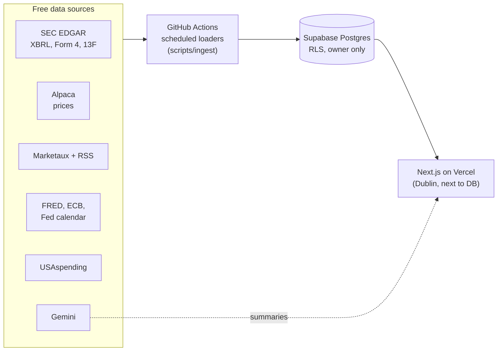

# Kairos

A personal research terminal for US equities, built on free public data. It covers fundamentals, prices, news, macro, insider trades, 13F filings and US federal contracts for ~12,000 US stocks and ETFs, and turns them into a transparent 0–100 **Kairos Score** and a rule-based bull/bear outlook. A small LLM layer writes Turkish summaries and translations on top.

The interface is in Turkish; code, comments and commits are in English.

> Kairos is a learning project, not investment advice. Numbers are computed in code; the LLM only rewrites facts it is given.

## What it does

| Area | Details |
|---|---|
| **Stock pages** | Quarterly financials from SEC XBRL, valuation multiples (P/E, P/B, EV/EBITDA, FCF yield…), valuation vs. the company's own history, earnings surprises, insider trades (Form 4), which notable funds hold it (13F), matched news and federal contracts |
| **Kairos Score** | Seven sub-scores (valuation 25, profitability 20, growth 20, health 15, momentum 10, sector 10, news 10), each a percentile rank within the GICS sector. Weights live in one file (`lib/score/weights.ts`) and missing parts are renormalised |
| **Outlook** | Bull and bear case from company data, own-history valuation, sector momentum, macro rules (rates, inflation, oil, dollar, jobs → sector effects) and federal spending themes. Every reason carries its source and date |
| **Screener & heatmap** | Server-side filters over precomputed metrics, preset screens, S&P 500 treemap |
| **Portfolios** | P/L, value history vs. SPY, volatility, drawdown, beta, concentration warnings, TRY view |
| **Macro & calendar** | FRED series, ECB USD/TRY, US data releases, FOMC dates, earnings calendar |
| **Federal spending** | USAspending contracts matched to listed companies by recipient-name normalisation and parent-company lookup; spending themes and NAICS growth |
| **Investors** | Small, concentrated funds that beat the S&P 500 over 8 quarters, found by scanning SEC's bulk 13F datasets; returns are derived from the filings themselves |
| **Alerts** | Price level, daily move and score alerts evaluated after each data load, with in-app notifications |

## AI features

- **Stock summary.** The outlook's computed facts are rewritten by an LLM (Gemini via an OpenAI-compatible endpoint, so the provider is swappable) into a short Turkish paragraph. The prompt forbids new numbers or buy/sell language. Generation never blocks the page: it runs after the response (`after()`), is stored per ticker, refreshes at most once a day or when the facts change, and the page polls until the new text lands.
- **Opinion extraction.** Posts from 10 independent investment writers (RSS) are read by an LLM that returns which stocks are discussed, the author's stance and a short summary. A ticker is only accepted if the company name the model gives matches our own listing; otherwise the name is searched. This fixed real errors such as LVMH's "MC" being mapped to Moelis & Co. If nothing is found, a stronger model gets a second read.
- **News translation.** Global headlines are translated to Turkish with a summary written only from the title and the source's own description.

## Architecture



- **Pages only read the database.** Loaders run on a schedule (`.github/workflows/data.yml`): prices on weekday evenings, news/macro/insiders daily, fundamentals/universe/spending weekly, bulk 13F monthly. A data-freshness badge shows the last successful load per group (`ingest_runs`).
- **Caching.** Market data is identical for every request, so readers use Next.js `"use cache: remote"` shared across serverless instances, behind an owner check on every request. User data (watchlist, portfolios, alerts) is never cached.
- **Storage budget.** The free database tier is 500 MB, so only S&P 500 + extra tickers keep daily price history; the other ~11,000 symbols are computed in memory during loads and fetched live (with a cache) on their detail pages.
- **Security.** Supabase Auth with email + password or magic link, a single allowed owner email, row-level security on every table, server-side verification in a data-access layer (the proxy alone is never trusted).

## Engineering notes

A few problems that took more than one try:

- **SEC quarterly data.** XBRL `frames` don't publish the fiscal Q4; it is derived as annual minus the first three quarters. Revenue needs two tags (and two more for banks), and Q3 filings include 9-month cumulative values that must be filtered by period length.
- **13F returns without a price feed.** Each holding's price is the median of value/shares across all filers in that quarter; SPY is measured the same way, so fund and benchmark share the same bias. Some funds still report values in thousands of dollars, which is detected and normalised.
- **Federal contract growth.** The Department of Defense reports late, so growth compares two 12-month windows that end 90 days ago.
- **Form 4 noise.** A company's filing list includes its insiders' trades in *other* companies; only rows whose issuer CIK is the company itself are kept.

## Stack

Next.js 16 (App Router, Cache Components) · TypeScript · Tailwind CSS 4 · Recharts · Supabase (Postgres, Auth, RLS) · Vercel · GitHub Actions · Vitest (96 tests across 24 files, covering metrics, score, screener, portfolio risk, 13F parsing, matching and the AI prompt)

## Running locally

```bash
npm install
cp .env.example .env.local      # fill in your own keys (all free tiers)
npm run veri:yukle              # first full data load (long: SEC and USAspending lookups)
npm run dev
```

Database migrations are in `supabase/migrations/`. Individual loaders: `veri:fiyat` (prices + metrics), `veri:haber` (news, calendars), `veri:makro`, `veri:harcama`, `veri:iceriden` (Form 4), `veri:yatirimci` (13F), `veri:gorus` (opinions). Tests: `npm test`.

## Project layout

```
app/(app)/        pages (Turkish routes: /hisseler, /tarayici, /portfoy, /makro, /harcamalar, /yatirimcilar …)
components/       UI
lib/data/         database readers (owner check + shared cache)
lib/metrics/      ratios, valuation history, earnings surprise
lib/score/        Kairos Score weights and calculation
lib/insights/     rule-based outlook and macro → sector rules
lib/ai/, lib/opinions/   LLM prompts and extraction with validation
scripts/ingest/   scheduled data loaders
supabase/         SQL migrations
```

## How it was built

Built in about a week, starting 2026-10-17, by pair-programming with [Claude Code](https://claude.com/claude-code). I made the product and data decisions, tested data sources before committing to them (`PLAN.md` records the spike results), and reviewed and checked the output against real filings.
